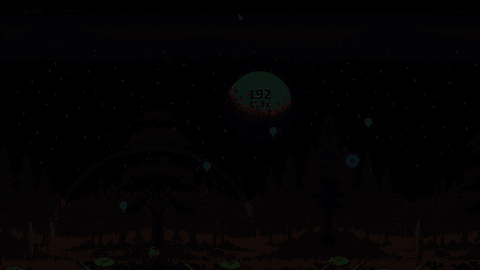

<div align="center">

# 🐸 Frogflies

**A one-button swinging arcade game — tap & hold to swing, reel and pump to build speed, catch fireflies to boost your multiplier, and outrun a wall of fire across four cosmic biomes.**

[](https://ace-ify.github.io/frogflies/)
[](LICENSE)
[](#-architecture)
[](#-running-the-game)

**▶️ [Play now at ace-ify.github.io/frogflies](https://ace-ify.github.io/frogflies/)** — no install, no build, runs in any modern browser.

<br>



<sub>▶️ Watch the [full promo video](assets/frogflies_promo.mp4) with sound</sub>

</div>

---

## ✨ Features

- **🪝 One-button pendulum physics** — hold to shoot your tongue at canopy hooks and swing with real tangential velocity math; release to sling forward with momentum.
- **🕸️ Full rope manipulation** — while hooked: `W/S` reels the tongue in and out, `A/D` pumps torque to spin full 360° loops over the hook, and holding in mid-air brakes into a glide.
- **✨ Guardian Firefly Swarm** — one emergency rescue per run: a cinematic slow-motion golden swarm scoops you out of fatal eliminations, then recharges after you collect 8 fireflies.
- **🔥 Firewall chase** — an accelerating inferno column hunts you from behind and keeps absorbing the world you pass through.
- **🌠 Four evolving biomes** — each with its own sky gradient, aurora, flora tint, weather particles and celestial body (blood moon → ringed exoplanet → solar supernova → black-hole singularity).
- **🌀 Chrono Portals** — warp through 3D portal gates to trigger full environmental metamorphoses between biomes.
- **🪞 Arcade presentation** — desktop / phone / arcade-cabinet view modes, toggleable CRT scanline overlay, threat-glow vignette, fullscreen support.
- **🎛️ Adjustables** — simulation speed hotkeys (0x pause up to 4x), hold-adjust speed dial, soundboard drawer, persistent local best score.

## 🌌 The Four Biomes

| # | Biome | Starts at | Portal at | Celestial body |
| - | ----- | --------- | --------- | -------------- |
| 1 | **Midnight Marsh** | 0 m | 8,000 m | Blood moon eclipse |
| 2 | **Bioluminescent Aurora** | 8,000 m | 15,000 m | Ringed exoplanet |
| 3 | **Solar Flare Inferno** | 15,000 m | 26,000 m | Pulsating solar supernova |
| 4 | **Void of Infinity** | 26,000 m | 40,000 m | Black-hole singularity |

Each biome re-tints the entire world — sky, water, canopy filters, aurora ribbons, ambient particles and the firewall glow — as you cross its portal.

## 🎮 Controls

| Input | Action |
| --- | --- |
| `SPACE` / Click / Touch (hold) | Shoot tongue & swing; release to launch forward |
| `W` / `S` | Reel tongue in / out while hooked |
| `A` / `D` | Pump swing torque (360° loops) while hooked |
| Hold in air | Brake — convert momentum into a glide |
| `R` | Restart run |
| `M` | Toggle sound |
| `1` `2` `3` `4` / `0` | Simulation speed 1x–4x / pause |
| `[` `]` | Speed down / up by 0.25x |
| `F` | Toggle fullscreen |
| `ESC` | Open / close the Settings drawer |

## 🎯 Scoring

- **Distance** accrues as you travel right, scaled by `SCORE_PER_DISTANCE`.
- **Every firefly devoured adds +0.1×** to your multiplier — bank it by surviving.
- Your **best score is persisted** locally and shown in the HUD and Game Over screen.

## 🚀 Running the Game

**There is no build step.** The game is a plain static site — any modern browser (Chrome, Edge, Firefox, Safari) plays it directly. You only need a browser with Canvas 2D + Web Audio support, and internet access for the two Google Fonts (the game falls back to system fonts offline).

### ▶️ Option 0 — Play online (recommended)

Head straight to **[ace-ify.github.io/frogflies](https://ace-ify.github.io/frogflies/)** — hosted on GitHub Pages, zero setup.

### Option 1 — Open directly

Clone the repo and double-click `index.html`, or drag it into a browser window.

```bash
git clone https://github.com/ace-ify/frogflies.git
cd frogflies
```

### Option 2 — Serve locally

```bash
# with Node.js (npm start / npm run serve)
npm start            # → http://localhost:8080

# or with Python
python -m http.server 8080
```

### Shipping / deployment

Copy the repository contents to any static file host (GitHub Pages, Netlify, itch.io zip, S3/CDN…). The only hard requirements are that `index.html`, `index.css`, `game.js`, and the `assets/` folder stay together with their relative paths intact.

> **GitHub Pages note:** this repo is already live at `https://ace-ify.github.io/frogflies/`. If you fork it, enable Pages under *Settings → Pages → Deploy from branch* (`main`, `/ root`) to get your own `https://<user>.github.io/<repo>/` link.

## 🗂️ Repository Structure

```
.
├── index.html            # Entry point — arcade shell, HUD, settings drawer, soundboard
├── index.css             # Arcade cabinetry, HUD and CRT-overlay styling
├── game.js               # The game: native Canvas 2D engine, physics, spawners, audio, biomes
├── assets/
│   ├── images/           # Sprites & background art (frog, hooks, lilypads, firewall, celestial bodies…)
│   ├── sounds/           # SFX & ambient loops in .mp3/.webm (dual-codec for cross-browser playback)
│   └── frogflies_promo.mp4 / .gif  # Promo video + README preview GIF
├── docs/superpowers/     # Design spec + implementation plan for the v1.1 feature work
├── LICENSE               # MIT license for this repository's source code
└── README.md
```

### 🏗️ Architecture

`game.js` is a **self-contained, from-scratch Canvas 2D engine** (~4,000 lines, no libraries, no iframes):

- **Fixed 60 TPS timestep loop** with a delta accumulator for frame-rate-independent physics.
- **Virtual 2048×2732 stage** scaled to fit any screen; the width expands with ultra-wide aspect ratios.
- **Procedural spawners** for hooks, lilypads, grass, lotus flowers, shooting stars, weather and rifts.
- **Web Audio / HTML5 audio manager** with dual-codec (.mp3 + .webm) fallback and a synthesized backup when files fail to decode.
- **Biome state machine** driving sky/water/flora color lerps, aurora intensity, weather particles and portal transitions.

## 🔗 Attribution & Notice

**Frogflies** © 2026 — the game code in this repository (`index.html`, `index.css`, `game.js`) is released under the **MIT License** (see `LICENSE`). The artwork and audio under `assets/` are part of this game and are covered by the same grant.

A brief credits line is also shown inside the game's Settings drawer.

## 📦 Third-Party Assets

The only third-party runtime dependency is **typography**, served via the Google Fonts CDN:

| Asset | Files | Source | License |
| --- | --- | --- | --- |
| **JetBrains Mono** font | loaded via Google Fonts CDN in `index.html` | JetBrains / Google Fonts | **SIL Open Font License 1.1** |
| **Outfit** font | loaded via Google Fonts CDN in `index.html` | The Outfit project / Google Fonts | **SIL Open Font License 1.1** |
| **"Bit Shift"** music track (promo video only) | `promo/bgm.mp3` — used as background music in the promotional video | Kevin MacLeod (incompetech.com) | **Creative Commons: By Attribution 4.0** — required credit kept in this table |

Everything else in this repository — engine code, styling, sprites and audio — is part of this project. There are no other runtime dependencies.

> **Note on bundled assets:** The origin and rights holders of some of the bundled artwork and audio files under `assets/` could not be verified. If any of these assets belong to you, please open an issue and they will be properly credited or removed.

## 🤖 AI Tools Disclosure

This project was developed with AI assistance, used as follows:

- **JetBrains IDE AI coding agent** — used during development to implement the feature work on `game.js` (Guardian Firefly Swarm rescue system, WASD/arrow-key rope controls, the four-biome environment system), the corresponding HUD/UI in `index.html` / `index.css`, and the design documents under `docs/superpowers/`.
- **Freebuff (Codebuff agent)** — used for production-readiness work: repository structure, this README, the `LICENSE` file, and verification of the build.

Everything AI-generated was human-directed, human-reviewed, and committed by the maintainer.

## 📄 License

This project's source code is released under the [MIT License](LICENSE).

---

<div align="center">
<sub>Built with 🐸 + Canvas 2D · Play it live at <a href="https://ace-ify.github.io/frogflies/">ace-ify.github.io/frogflies</a></sub>
</div>
